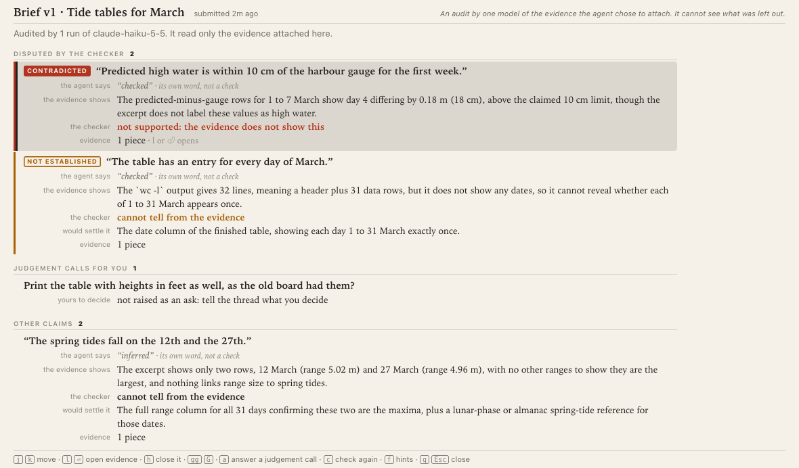

# 🐄 cow

cow is a plugin for [bb](https://getbb.app). If you run your work through one
long-lived agent thread that hands jobs to other threads, cow gives you one
page for all of it: every thread that was started, what state it is in and
for how long, what it is doing, and, in a queue of its own, only the things
that are waiting on you. You drive it from the keyboard, in the manner of
vim. It is for someone who has more agent threads open than they can keep in
their head.




The pictures are of invented threads made for this page, in cow's own theme.

## Contents

[Install](#install) · [The first five minutes](#the-first-five-minutes) ·
[The ideas](#the-ideas) · [Keys](#keys) · [The CLI, for agents](#the-cli-for-agents) ·
[What cow stores and sends](#what-cow-stores-and-sends) ·
[Limits, and what cow rests on](#limits-and-what-cow-rests-on) ·
[Updating](#updating) · [Removing](#removing) ·
[Developing and testing](#developing-and-testing) · [Licence](#licence)

The rules behind each idea, in full, are in
[docs/reference.md](docs/reference.md). What changed between versions is in
[CHANGELOG.md](CHANGELOG.md).

## Install

You need bb 0.49 or later (0.50.1 is the one tested) and `git` on your `PATH`.

```sh
bb plugin install 'git:https://github.com/jamie-meyer/cow.git@^0.2.0'
```

bb shows the source and the exact tag and commit it resolved, and asks before
it installs. A plugin is code that runs inside bb's server with full trust,
so read that line. Then bb clones the repository, installs cow's one runtime
dependency ([zod](https://zod.dev)) from the npm registry without running any
install script, and builds the page and the backend itself. Nothing built is
committed to this repository, and there is no release asset to download.

Check that it is there:

```sh
bb plugin list        # cow@0.2.6  running
bb cow help
```

Then open cow from its entry in bb's navigation, or go to
`/plugins/cow/main` at the address you open bb at. Do that once yourself,
straight after installing and before any agent runs: the first browser to
open the page is the one cow will take your actions from (see
[Signing](#the-limits-of-signing-and-capabilities)).

The quotes are there because some shells give `^` a meaning of their own.

Other ways bb can install it, and when to prefer them:

| Command | Follows | Use it when |
| --- | --- | --- |
| `bb plugin install 'git:https://github.com/jamie-meyer/cow.git@^0.2.0'` | tagged releases from 0.2.0 up to, not including, 0.3.0 | the default: `bb plugin update cow` brings fixes and nothing else |
| `bb plugin install git:https://github.com/jamie-meyer/cow.git@v0.2.6` | that one tag; bb refuses it if the tag is ever moved | you review a version before you run it |
| `bb plugin install https://github.com/jamie-meyer/cow` | the default branch, every commit | you want what is newest and accept what is unreleased |
| `git clone`, `npm install`, `bb plugin install .` | your checkout, in place | you are changing cow: see [Developing and testing](#developing-and-testing) |

cow is not on npm and not in a bb marketplace.

## The first five minutes

1. **Open cow.** With no Main chosen, the page says what it is for and lists
   your threads. A **Main** is the one long-lived thread you talk to and ask
   to hand work to others. Move with `j` and `k`, choose with `Enter`. If you
   have no thread yet, start one in bb and come back. `M` changes Main later.
2. **Read the notice about the key.** The first browser to open cow has a
   signing key made for it and enrolled, and the page says so with the key's
   fingerprint. From then on, what only you may do on the page is signed with
   that key. Press `f` and the letter on "understood", or click it. `C` lists
   the enrolled keys whenever you want to see them.
3. **Give Main something to delegate.** Press `i`, type a request that needs
   more than one thread ("start a thread that … and another that …"), and
   `Enter`. Each thread Main starts appears as a line under the heading, and
   threads those start are indented under them.
4. **Look around.** `j` and `k` move between lines; `Enter` opens a line's
   chat beside the list and `Esc` closes it. `?` opens the legend: every mark
   and every key. `f` puts a letter on everything you could click.
5. **Deal with what waits on you.** The queue at the side is only that. `Tab`
   goes to its next entry; `a` on a line answers its question or its
   permission request; `Space` marks a reply as seen.
6. **Settle what finished.** A finished thread waits under To settle for
   one decision: `e` archives it with a reason, `p` parks it with a date to
   pick it up (it comes back to the queue by itself), `z` keeps it around
   asking for nothing, or `Enter` and `i` carry on with it. `u` undoes the
   last of these.
7. **Let agents use it.** cow ships a skill that bb gives to every agent
   thread, so agents know the `bb cow` commands without being told. From a
   terminal, `bb cow status` prints the same overview as text.

If cow's own look appeals, `bb theme set plugin:cow:cow` turns on its theme
for the whole of bb, and `bb theme reset` goes back. The page mentions this
once.

## The ideas

Each of these has a section with the full rules in
[docs/reference.md](docs/reference.md).

**Main, projects and workers.** Main is the page's heading. A thread Main
started is a line; a thread with threads under it is a **group** that folds
(`h`, `l`). A **project** is a thread you talk to over days: Main, any group's
head, or a line you mark with `P`. A project is never done; quiet, it reads
idle and keeps its place. Everything else is a worker: it does a job, reports
to the thread that started it, and reads done: it waits under To settle for
you to decide what becomes of it. Each window keeps its own Main.

**Lines and states.** A line shows a state mark, time in that state, the
thread's name, what it is doing or waiting on, and the next move.

| Mark | State | Means |
| --- | --- | --- |
| ● | wants you | it asked you something, or replied to you and you have not seen it |
| ⊘ | blocked on a permission | bb refused it a command or a file change without asking you |
| ▶ | running | a turn is in progress |
| ◷ | waiting | on someone other than you: a reviewer, CI, someone outside the team; said by its agent or by you with `w` |
| ◆ | stuck | running with no event for 2 hours, or a question, a permission request or an ask waiting on you for 7 days. A reply never reads stuck |
| ‖ | parked | you set it aside; it is on the shelf until it comes back |
| ⌂ | kept | you keep it around with `z`; it asks for nothing until it starts a turn |
| ✕ | failed | its last turn ended in an error |
| ○ | idle | a project with nothing to say |
| ✓ | done | finished, and waiting under To settle for your decision; or archived, and listed under Archived for 2 days |
| ◌ | not started | not a thread: work a thread has listed for later |

**The queue.** Only what is yours, oldest first: asks, questions, permission
requests, permissions bb refused without asking, failures, briefs with
disputes or judgement calls or whose check could not run, replies addressed to you, parked work that has
come back, work waiting on someone else whose reminder has come,
capabilities you have not acknowledged, and permission requests decided
somewhere other than cow. `Tab` and `1` to `9` jump to an entry. A reply you
mark seen leaves the queue but its line stays where it is, dimmed, until you
reload the page. A reply is in the queue only when it ends the thread's
newest turn and you started that turn (or spoke into it while it ran), for
Main and projects as for workers: a worker's report on its job, a project's
reply to a report from a thread under it, or a turn another agent started,
is not yours to act on now. On a project or Main such a reply, unseen, puts
a small dot after its name instead; opening its chat or `Space` clears it.

**To settle.** A finished thread that is not archived waits here for one
decision: archive it (`e`, with a reason), park it (`p`), keep it (`z`), or
carry on with it (`Enter`, then `i`). Lines with a reply you have not seen
come first, marked unread, then the oldest. Nothing is hidden by age: the
age on a line turns warm after 3 days and red after 7, and the heading's
count takes the colour of its oldest line. That never puts a line in the
queue. Each line says what archiving it would leave behind: a reply you have
not seen, an open ask, a brief not read. `h` on the heading folds the
section, and the window remembers.

**The ledger.** When you archive a finished worker, `e` first asks what it
came to: `1` done (the work was used as it came back), `2` partial (some of
it was used, or it needed a second worker), `3` redone (it was wrong, and
you or another thread redid it), `4` dropped (it was not used), or `Enter`
to leave it unsaid. `o` under Archived or To settle sets or changes it
later, signed as yours; an agent that archives a worker it dispatched gives
one with `bb cow archive --outcome`, and can never overwrite yours. Each
worker archived through cow gets one row in cow's storage: its model and
effort, its time to first report, how many times you and other threads
steered it before that report, its turns, its outcome and who judged it.
No titles, prompts or message text. A dispatching thread can give a worker
a label, one short word for the kind of job (`bb cow label <thread>
code-change`), so you can see whether each kind of job is on the right
model. `L` shows the last 14 days by model, by dispatching thread and by
label (and by model within each label; `b` shows one grouping at a time);
`bb cow ledger [--by label]` gives the same, and the rows.
Each row also holds the tokens the worker used, as bb recorded them, and
each group shows its tokens, their dollars at list price and the dollars per
done outcome: what each kind of job costs when it works. `L` and `bb cow
spend` add the last 30 days' tokens and dollars for everything under Main,
archived or not: workers, project threads, Main itself and cow's checker
runs. **Dollars are an estimate at the providers' published list prices,
not a bill:** on a subscription you are not billed this. The setting
`listPrices` changes or adds prices.
Details are under [The ledger](docs/reference.md#the-ledger).

**Usage, and a budget.** One quiet line above the status line shows every
usage window bb reports for each signed-in provider (Claude Code's weekly
limit and its per-model one, Codex's, any provider's), each with its percent
and when it resets, and the last 30 days' list-price dollars of every thread
on this bb (today and the 29 days before it, a running total); with a
`budget30Days` set, the budget beside them. When a window reaches
`usageWindowPercent` (80), or the last 30 days' dollars reach 80% of the
budget or the budget itself, cow puts one notice in your queue, once per
window per reset period, and once per budget mark until the total has fallen
below it and risen to it again, and sends the same text as a notification
unless `usageNotify` is off. (`budget30Days` was `monthlyBudget`; a
`monthlyBudget` already set is read as it.) cow's server checks every five
minutes, page open or not. **It only tells:** nothing is paused or stopped,
and no agent is shown the budget. `bb cow usage` prints the same. Details
are under [Usage and a budget](docs/reference.md#usage-and-a-budget).

**Caps and stuck checks, shown only.** cow keeps a small record of each
running worker's progress: its tool calls, its turns' times, its last event,
what is in progress, and its last few calls as a kind, a hash and a clipped
label (no message text, output or file contents). The setting `caps` (JSON
keyed by label, `*` for any other, each with any of `toolCalls`, `minutes`
and `dollars`; empty means none) and three stuck checks, on by default (the
same call 3 times in a row, a running turn quiet for 15 minutes, one item in
progress for 45; 0 turns each off), put a mark on the worker's line, such as
`over cap: 41 of 40 tool calls` or `quiet 22m`, and one notice per worker per
reason in your queue, sent as a notification too unless `watchNotify` is
off. **cow never stops, pauses or messages the worker.** A `dollars` cap is
known once a turn has ended; with `liveUsage` on (off by default), cow reads
a running Claude Code worker's token counts from its transcript, so the cap
applies during the turn and its line shows `$0.42 so far`; bb's own figure
replaces the reading when the turn ends. Details are under
[Caps and stuck checks](docs/reference.md#caps-and-stuck-checks).

**Merge-readiness, shown only.** A finished worker on a branch with commits
of its own says, beside what it is doing, whether that branch still fits
the branch it will be merged into: `3 behind · merges cleanly`, quietly, or
`conflicts in 2 files`, loudly, the files named in its tooltip, in its
context card and in `bb cow status`. The base is the local branch bb says
the worktree was made from, otherwise the repository's default branch as
found locally. It is worked out read-only by a trial merge (`git merge-tree
--write-tree`, git 2.38 or later) that writes nothing into the repository
and fetches nothing, again only when the branch's tip or the base's moves,
and anything that fails reads "not known", never "clean". Uncommitted
changes are not in the trial merge, and the line says when there are some
(cow works that out itself, with a git that starts no program the checkout
names: see "git in a thread's folder" under the limits of signing and
capabilities).
A conflict also shows beside a brief you have not read or an ask about
merging, and never queues anything by itself. **cow never merges.**
Details are under [Merge-readiness](docs/reference.md#merge-readiness).

**Kept.** For a thread you want around without it asking for anything, an
idea you are sitting on, say: `z` keeps it, with a few words or none. It
goes to the Kept section, folded by default, never coloured, with no
reminder of any kind. Only what truly needs you shows through, as on a
parked line: its open ask. It comes off the shelf by itself when it starts a
turn, as when you type to it; `z` on it takes it off too.

**Outside Main.** Open threads with no parent are not under any Main, so the
tree never reaches them: old work, threads started by hand, forks. The
**Outside Main** section, just above Archived and folded by default, lists
them with their project when it is another one, how long since each did
anything, and whether it is running, wants an answer or is at rest. Nothing
in it is in the queue. Threads a plugin started are only counted, except
an automation's runs, which are listed under Automations. `A` on one
brings it under Main, `u` takes that back. `e` archives one with a reason,
as on any line; it is then listed under Archived for two days, and `u`
takes that back too.

**Automations.** Each run of a bb automation is a new thread with no parent,
so the tree never reaches it. The **Automations** section, after Kept
and folded by default, has one row per automation: its name, its project
when that is not Main's, when it runs next ("in 3h", "tomorrow 09:00",
"paused") and what its last run came to, with the first line of the error
when it failed. Its recent run threads fold under it as ordinary lines. A
run that asks you something is in your queue like any thread; a finished
one is not, and is never coloured. `e` archives a run. On an automation's
row, `e` deletes the automation, once you confirm it with `y`; its past run
threads stay, and nothing undoes it. cow does not pause, run or change
automations. Without bb's automations plugin there is no section.

A script automation's run has no thread. When the script starts one itself
(`bb thread spawn … --json`), it can say so with
`bb cow automation started "$id" --automation "$BB_AUTOMATION_ID" --run "$BB_AUTOMATION_RUN_ID"`,
and cow lists that thread under the automation like an agent run's, no
longer under Outside Main; `--clear` takes the record back. It is cow's own
record: nothing in bb changes and nothing is re-parented. Any thread or
script on this machine can call it, and each record made or cleared goes in
cow's log. See [Automations](docs/reference.md#automations).

**Waiting on someone else.** A thread whose next move is a reviewer's, CI's
or anyone's but yours says so with `bb cow wait`, or you do with `w`. Its
line keeps its place and reads "waiting on the reviewer · 3d", out of the
queue. It clears when the thread starts a new turn. With a reminder it comes
back to the queue on that day, and `a` keeps it waiting or takes it back.

**Answering, and permissions.** `a` opens whatever the line asks under the
line. A digit only marks a choice and `Enter` sends it, so no single key
answers or grants anything. For a permission request you see the exact
command or the file and its diff, and bb's choices. When bb refused something
without asking (it does that on a turn another thread started), `a` offers to
ask again as you, after which bb does ask.

**Worker rules.** A thread whose first message begins with the line
`WORKER BRIEF` is a worker, and cow gives its agent the rules in
[rules/worker.md](rules/worker.md) as part of its instructions: stay in
scope, report to whoever dispatched you, do not merge, how to end. So
briefs need not carry them, and they come to any machine with cow. The
setting `workerRules` turns this off; `workerRulesExtra` adds a machine's
own lines. It gives text and enforces nothing.

**Rules for asking you.** The threads you talk with (a chosen Main, a
thread marked as a project, and a thread whose first message begins with
the line `PROJECT BRIEF`) get [rules/lead.md](rules/lead.md) instead: put
everything that waits on you through `bb cow ask`, one decision per ask,
and close an ask you answered in chat. So a thread with nothing open on
the page really needs nothing from you. `leadRules` turns this off;
`leadRulesExtra` adds a machine's own lines.

**Asks.** A question an agent writes in prose scrolls away. `bb cow ask`
records one question that stays in your queue until you answer it on the page
or the thread withdraws it. The agent can give options and say how much is at
stake; a high-risk answer has to be typed out before it is sent. Your answer
reaches the thread as a message from you.

**Briefs and the checker.** A finished job is reported with
`bb cow brief submit`: a list of claims, each labelled by the agent as
checked, inferred or not checked, with its evidence. cow has a separate agent
audit it. A finished job is put in front of you only for its exceptions: a
dispute, a check that could not run, or a decision that is yours. Then `b`
opens on "Needs you", a line for each, worst first, with the key that acts
on it, and folds the rest under one line that counts it. The checker is
not shown the agent's summary or its labels: it gets the claims and their
evidence, the task the thread was started with (read by cow, with each check
of its "Done means" section, which it answers for too), and what the thread
changed (the files and the diff, collected by cow from its git checkout,
or in a copy-on-write workspace from the folder and each repository it
brought, clipped). A diff that changes an existing test, or the configuration of CI, a
linter, a formatter, a type checker or a test runner, is a dispute cow raises
with no model. A check is one model's reading of that material. It is not
proof, and a failed check is shown as a failure, never as a pass.

**Parking.** `p` takes a line off the tree with a reason and a pick-up: a
date, `+3d`, `+2w`, a condition in words, or nothing. It returns to the queue
when the date arrives, or every four weeks without one, and then `r` resumes
it, `p` keeps it parked and `x` drops it.

**Capabilities.** A worker that must write outside its workspace, or run a
command outside bb's sandbox, raises a permission request each time. A
capability is a named grant (write under one directory, or run one command)
for one thread, a thread and everything under it, or everything under Main.
When a request is covered entirely, cow answers bb "allow once" for you and
writes it in a log. Only you make and delete capabilities (`C`), and every
new one sits in your queue until you acknowledge it.

**Signing.** bb does not tell a plugin who is calling it, and serves a
plugin's interface to any local process. So everything only you may do
(answering an ask, deciding a permission request, sending a message as you,
making or deleting a capability, approving a key, and taking a line out of
your queue by marking a reply seen, dismissing a refusal or reading a brief,
and deleting an automation)
is accepted only when it is signed by a key your browser holds. The first page to open cow is enrolled;
any other browser asks and is approved from an enrolled one. This has limits,
stated in [What cow stores and sends](#what-cow-stores-and-sends).

**The context card.** Under the queue, just above the legend, the selected
line's thread shows what bb's own plugins know of it (its pull request with
its checks and review, and its changed files) and whatever other plugins add
for it, such as a stack of pull requests. With a chat open, the same card is
at the top of the pane. A thread with nothing to show has no card; `v` hides
it in the window. Any plugin can add sections by offering one method,
`cow_card`: the contract is cow's own and may change before 1.0, see
[The context card](docs/reference.md#the-context-card).

**The reader, and links.** A file named in a chat, a brief or an ask opens
over the page, read-only, with vim's keys for moving and searching. A link to
a thread in the chat opens that thread in the pane instead of bb's chat page;
`Esc` goes back to the chat you came from.

**A copy-on-write workspace (macOS).** A thread can start in a clone of a
whole workspace folder, with the repositories it needs cloned inside it,
instead of a git worktree: fast, nearly free on disk, and independent of the
originals. It is started from the command line for now. A
`cow.workspace.json` in the workspace folder can name the repositories and
the commands you write to keep them in sync, set a clone up and bring a
thread's work back (git, a stacking tool, anything); none of them runs until
you approve the file's content on the page, and each change waits for you
again. A brought repository marked `"branch": "keep"` stays on its own
branch instead of getting the thread's. A file that git or an editor
deletes while the clone is made (`.git/index.lock`) is left out instead of
failing it. When the clone is removed, work that is neither in its source
nor in one of the clone's remote-tracking refs (pushed, or fetched) holds it
for you to look at; cow trusts the clone's own record of the remote, and
contacts none. Details are in [docs/clone.md](docs/clone.md).

## Keys

The page starts in normal mode. Typing in any field works as usual, and while
a prompt is open no key does anything else. Select a line, then press a verb:
the bar at the bottom shows which verbs apply to it, and a greyed-out one
says why, and what to press instead. `?` shows this map on the page.

**Moving around**

| Key | Does |
| --- | --- |
| `j` `k` | next, previous line (arrows work too); the heading, Main, is the line above the first |
| `gg` `G` | the heading, the last line |
| `h` `l` | fold, unfold a group, or the To settle, Kept, Automations and Outside Main sections on their headings, or an automation's runs on its row; on a member, h goes to its group's head or its section's heading, and on a run to its automation (left, right arrows too) |
| `Tab` | next entry in the queue of what waits on you (Shift+Tab previous) |
| `1` to `9` | jump to that entry in the queue |
| `/` | filter: type to narrow the page to matching lines; Ctrl+n, Ctrl+p or arrows move, Enter keeps the line, shown and unfolded so j reaches what is under it, Esc cancels |
| `f` | letter hints on every line, action, link and button in view, the chat's included; again for a menu it opened. A hint on a file opens it in the reader, and one on a link to a thread opens that thread in the pane |

**Reading a thread and talking to it**

| Key | Does |
| --- | --- |
| `Enter` | open the line's chat beside the overview, or switch the pane to it; it never types into the chat. On an automation's row, its latest run's chat, or for a script what its last run printed, in the reader |
| `m` | open Main's chat the same way |
| `;` `'` | scroll the open chat down, up a few lines, from the overview; : and " by half a page; \ goes to its newest message |
| `i` | type in the chat that is open, wherever the cursor is: the only key that does; with no chat open, say something to Main |
| `I` | say something to the selected thread |
| `Esc` | leave the chat, then close it; after following a link to a thread in the chat, it first goes back to the chat you came from, as many times as you followed one; cancel a prompt |
| `Cmd+[` `Cmd+]` | bb's back and forward: walk the chats opened on this page, closing the pane included. The page's address names the open chat, so a reload reopens it; a chat reopened that way marks no reply seen until you open it with Enter |

**Dealing with what waits on you**

| Key | Does |
| --- | --- |
| `a` | answer the line's ask or question, grant or deny its permission request, or deal with a permission bb refused: digits choose, Enter confirms; an ask with more at stake is shown back first, or needs a word typed. A request or a refusal can be saved as a capability from its card. On a thread's request for a capability (its line says press a to allow or refuse), 1 allows it: the steps open at once and end in a confirmation; 2, then Enter, refuses it |
| `b` | open the line's brief over the page: what needs you first, the rest folded (l unfolds it). In it: j k move, l or Enter opens a claim's evidence, h closes it, a answers a judgement call, c runs the check again (y confirms), q or Esc closes |
| `Space` | mark a reply as seen: the line stops waiting on you, and stays where it is, dimmed, until the page is reloaded; on a line to settle, or a project or Main marked with the unread dot, it is no longer unread; on a line whose request was decided outside cow, acknowledge that |
| `w` | say the line is waiting on someone else: who or what, then a reminder (19 Nov, +3d, +2w) or nothing. On a waiting line, w clears it (y confirms); when its reminder comes, a keeps it waiting or takes it back |

**Setting work aside, ending it, taking it back**

| Key | Does |
| --- | --- |
| `p` | park it: a reason, then 19 Nov, +3d, +2w, a condition, or nothing |
| `r` | resume a parked line: back into the tree |
| `e` | archive a done, idle, waiting, kept or failed line, or a line in Outside Main at rest with nothing open under it: a reason or nothing, then Enter. On a finished worker (done, waiting or kept; not a project, Main or an automation's run) it first asks what it came to: 1 done, 2 partial, 3 redone, 4 dropped, or Enter to leave it unsaid. On an automation's row, delete the automation (y confirms): its past runs stay, and u cannot bring it back |
| `z` | keep a line that is not running: it goes to Kept, asks for nothing and reminds you of nothing, until it starts a turn. A few words or nothing, then Enter. On a kept line, z takes it off Kept |
| `x` | stop a running turn (y confirms); on parked work that came back, drop it, with a reason; on a not-started item, remove it |
| `A` | on a line in Outside Main, bring that thread under Main (y confirms): Main gets a short notice from bb and starts a turn, and the thread's notifications to Main are set to stuck, so it does not wake Main each time it finishes a turn |
| `u` | undo the last park, resume, archive, dismissal, mark as seen, project mark, wait, keep or move under Main (y confirms). A sent message, an answer, a decision and a stopped turn cannot be undone |
| `P` | mark a line as a project, or unmark it: a project is never done; when quiet it reads idle and stays in the tree |
| `J` `K` | move a not-started item down, up its list |

**What finished work came to**

| Key | Does |
| --- | --- |
| `o` | on a line under Archived or To settle, say what the worker came to, or change it: 1 done (the work was used as it came back), 2 partial (some of it was used, or it needed a second worker), 3 redone (it was wrong, and you or another thread redid it), 4 dropped (it was not used); any other key cancels. Signed as yours: no thread can overwrite it |
| `L` | the ledger over the page: for the last 14 days, by model, by dispatching thread and by label (the kind of job, then by model within it), how many workers, each outcome, the median time to first report and steers before it, how many you judged, the tokens and list-price dollars and the dollars per done; then the latest rows, and the last 30 days' tokens and dollars under Main (workers, project threads, Main, cow's checker runs). Dollars are an estimate at list price, not a bill. It holds no titles, prompts or message text. b shows one grouping at a time, j k scroll, q or Esc closes |

**Capabilities and this page's key**

| Key | Does |
| --- | --- |
| `c` | show the capabilities the line's thread holds, and where each comes from: itself, a thread above it, or Main; c or Esc closes |
| `C` | the capabilities sheet over the page: n makes one, x deletes (y confirms), u undoes a delete, Enter shows its history, Space acknowledges a new one, a decision made outside cow, or what an agent took out of your queue (on that, Enter opens the thread's chat), Tab shows the log, q or Esc closes. It also lists the keys enrolled to act as you, this page's among them: Enter approves a page that asks, x refuses or removes one |

**Reading a file**

| Key | Does |
| --- | --- |
| in the reader | a file opens over the page, read-only: j k move, Ctrl+d Ctrl+u half a page, Ctrl+f Ctrl+b a page, gg G and 12G, { } by block, / searches with n N, f hints its links, r raw Markdown, u splits a diff, y Y copy the path, o opens it in bb's panel, q or Esc goes back |

**Workspaces**

See [Copy-on-write workspaces](docs/clone.md#the-workspace-file).

| Key | Does |
| --- | --- |
| `W` | the workspaces sheet over the page: each workspace folder cow knows, whether its cow.workspace.json is approved, and each repository with its last sync, whether it is dirty and which commands it has. j k move, s syncs the selected repository, S every approved workspace, Enter shows the selected one's last sync output in the reader (signed: output may hold secrets), or says it never ran; r opens its workspace's file when it has changed since you approved it; below them the held clones (bb removed them, cow kept them since work might be lost): Enter shows what their teardowns printed (signed), t runs the approved teardown again and removes the clone when nothing holds it any more, d asks to remove one for good, naming what would be lost, and y confirms (each signed); q or Esc closes |
| on a workspace notice | a workspace file that is new or changed waits in the queue; a click or its hint opens it in the reader: the commands that would newly run first, then the change. There a approves exactly the content shown (refused if the file changed since), x dismisses it without approving until it changes again. Signed: no thread can approve |
| on a held-clone notice | a clone bb removed that cow held back (a teardown failed, or a repository without one held unsaved work) waits in the queue until you decide; a click or its hint opens W on it |
| `B` | on a thread that runs in a copy-on-write workspace, bring its work back: names each repository with new commits and the approved back command it would run, then y runs them in the sources (signed); any other key cancels. This is the only way a back command runs |

**Other plugins**

Other plugins can put a short badge at the end of a thread's line, and offer
actions for a thread, through bb. They draw and run these, not cow: see
[Other plugins on a line](docs/reference.md#other-plugins-on-a-line).
The selected thread's context card shows what bb and other plugins know
about it: see [The context card](docs/reference.md#the-context-card).

| Key | Does |
| --- | --- |
| `v` | hide or show the context card in this window, which remembers it across a reload: what bb and other plugins know about the selected line's thread (its pull request, its changed files, and any section another plugin adds), at the bottom of the right column above the legend, or at the top of the chat pane for the open chat, folded there to its section titles when it is long. It is no stop for j and k; f hints its links, files and folded titles |
| `.` | list what other plugins offer for the line's thread, such as a pull request's checks or a restack: a digit or letter runs one, in that plugin's own code and under its authority, not cow's; one with choices shows them next, and Esc goes back. A dimmed one is turned off by its plugin. Esc closes the list. The verb bar shows . more only when there is something to list |

**The page itself**

| Key | Does |
| --- | --- |
| `M` | choose a different Main for this window |
| `Ctrl+Option+C` | from anywhere in bb (a thread's chat, another page, settings): open cow's page. On the page it does nothing, so the open chat and the selection stay. Ctrl+Alt+C off macOS; rebind it in bb's keyboard settings as "🐄 cow: open cow's page", which is in bb's command palette too |
| `?` | this legend; ?, q or Esc closes it |

A confirmation takes `y`; any other key cancels it. Keys with Cmd, Ctrl or
Alt are left to bb, apart from the ones named above.

Scrolling by key is eased: a press goes a step, a held key glides at a steady
speed until it is let go, half pages and the ends take a short fixed time, and
the list follows its cursor the same way. With the system's "reduce motion"
setting every one of them is a jump. A click on the page, a text selection in
the chat included, leaves the keys with cow; only a field you type in keeps
them, until Esc. While focus is in bb's own fields, menus or panels, or another
plugin's, cow's keys do nothing.

## The CLI, for agents

`bb cow` gives an agent what it is meant to do: raise an ask, submit a brief,
ask for a capability, leave the notes the page shows, and read the overview.
The plugin ships a skill, [`skills/cow/SKILL.md`](skills/cow/SKILL.md), which
bb gives to agent threads and which says when to use each.

```sh
bb cow status [--main <thread>]                  # the overview as text
bb cow ask --question <text> [--option <label>[::<detail>]]... [--risk low|medium|high] [--context <text>] [--proof <path>]...
bb cow asks [--thread <id>] [--all]
bb cow ask withdraw <id>
bb cow ask close <id> --answered <the answer you were given>
bb cow brief submit <file.json> [--wait]
bb cow brief show <thread>
bb cow brief check <thread>                      # not on your own brief
bb cow caps                                      # the capabilities your thread holds
bb cow caps log
bb cow cap request --kind dir|command --rule <text> --why <text>
bb cow next <thread> "<text>" | --clear          # what is next, in the thread's own words
bb cow wait <thread> --on <who> [--for <what>] [--remind <date|+3d|+2w>] | --clear
bb cow todo add|done|rm|list <thread> ...        # work not started
bb cow project <thread> [--clear]
bb cow park <thread> --reason <text> [--pickup <date|+3d|+2w|text>] [--stop]
bb cow resume <thread>
bb cow archive <thread> [--reason <text>] [--outcome done|partial|redone|dropped] [--label <label>]
bb cow outcome <thread> done|partial|redone|dropped [--label <label>]   # what a worker came to, open or archived
bb cow label <thread> [<label>] [--clear]        # the kind of job, for grouping the ledger
bb cow ledger [--days 14] [--by model|dispatcher|label] [--json]   # what finished workers came to, and their tokens and list-price dollars
bb cow spend [--month YYYY-MM] [--main <thread>] [--json]          # the last 30 days' (or a month's) tokens and list-price dollars under Main
bb cow spend forget --deleted [--yes] [--json]                     # remove the kept usage of deleted threads (lists them without --yes)
bb cow usage [--json]                            # the usage line: each provider's usage windows, the last 30 days against the budget
bb cow workspace [<folder>]                      # workspace files: approved or not, each repository's last sync
bb cow workspace add <folder>                    # propose one: you approve its file on the page
bb cow workspace sync [<folder>] [--only <as>]   # run the approved sync commands
bb cow workspace back <thread>                   # what B would run for it; runs nothing
bb cow help
```

Every command takes `--json` and `--help`. A refused command exits non-zero,
says why, and says what to do instead. There is no command that answers an
ask, decides a permission request, makes, deletes or acknowledges a
capability, or approves a workspace file: those are yours, on the page.

Parking a thread that waits on you, withdrawing an ask, and closing an ask
as answered when you have not written to that thread since it asked, are
shown to you: a notice in your queue until you acknowledge it, in the log,
and in `bb cow status` under a heading of its own. Agents are told this is
no reason to avoid them when they are right.

## What cow stores and sends

Written for someone who has to decide whether this may run on their machine.
Each statement is about the code in this repository at this version; how it
was checked is at the end.

### What is stored, and where

Everything is on the machine bb's server runs on, on the machine a
copy-on-write workspace is on (the same one, unless you run bb's host on
another), or in your browser. cow has no storage of its own outside bb's data
directory and a temporary folder.

| Where | What |
| --- | --- |
| bb's database (`bb.db` in bb's data directory, which `bb status` prints), table `plugin_kv`, rows with `plugin_id = 'cow'` | Which thread is Main for each bb project. Which reply of each thread you have seen. Every ask: the question, options, context, the answer you gave, and when. Every brief: its claims and a copy of the text of each piece of evidence as it was when submitted, with the checker's verdicts and, for a failed check, the checker's raw answer; what the checker was shown besides (whether it had the task and its checks, the base revision, in a copy-on-write workspace each repository's folder name and base or why it was not read, up to 300 changed file paths, what was cut and the flagged files), and, in rows of their own, the text it was shown: the task (up to 12,000 characters), the whole list of changed files and the clipped diff (up to 60,000 characters). Every capability, its notices, and counts of use. The log: each capability made or deleted, each request a capability allowed, each decision made on the page, the first 300 characters of each message sent as you, each ask answered, each reply marked as seen, refusal dismissed and brief marked as read (and each of those taken back), each Main recorded, each outcome judged on the page, each key enrolled, requested, refused or removed, and each reset, with the fingerprint of the key that signed it. The public halves of the enrolled keys. The ledger: for each worker archived through cow, its thread's id, project's id and dispatching thread's id, its model and effort, when its first turn started and its first report ended, its counts of steers and turns, its outcome with who judged it and when, its label, its four token counts, and when and by whom it was archived; each judgement of its outcome; and each worker's label with who set it and when. For each thread cow has read the usage of: its token counts by day and model, the last cache lifetime bb reported, the last event read, which provider sessions started a new process since, its parent thread's id, its project's id, whether it is one of cow's checker runs or a project thread, and, once bb deletes it, when cow found that out (no title, no text). A deleted thread's token counts are kept until you forget them (`bb cow spend forget --deleted --yes`); a worker deleted before 0.2.24 gets them back from its ledger row. The usage notices waiting (their sentence and when), and which windows and budget rules were last told of, with their reset time or when. Which threads are workers given the worker rules, and which started with a project brief: each one's id and when it was recorded. Which threads are marked as projects, mirrored from their metadata: each one's id and when it was marked. No title, prompt, message text or reason. For each running worker cow watches, its progress: counts of tool calls and turns, their times, the kind and a hash of each of its last few calls with a label of at most 60 characters (the first line of a command, or a tool's name), and where it last read in Claude Code's transcript when `liveUsage` is on; and the worker notices waiting (their sentence and when). Each workspace folder cow knows, with the whole content of its `cow.workspace.json` as you last approved it, that content's hash, when and by which key, and the hash of a changed file whose notice you dismissed. For each thread a script automation said it started, the automation's id, the run's id when given, and when |
| the same database, table `thread_plugin_metadata`, rows with `plugin_id = 'cow'` | cow's notes on a thread: why it is parked and until when, why it was archived, which refused permissions you dismissed, what the thread says is next and has not started, who or what it says it waits on and when to remind you, whether it is marked a project, whether you keep it and in what words |
| the same database, table `plugin_settings` | cow's 20 settings: `checkOnSubmit`, `checkerModel`, `checkerProvider`, `checkerRuns` and `checkerDiff` for the checker (below); `workerRules`, `workerRulesExtra`, `leadRules` and `leadRulesExtra` for the rules; `budget30Days`, `monthlyBudget` (its old name), `usageWindowPercent` and `usageNotify` for the usage line; `listPrices`; and `caps`, `stuckRepeats`, `stuckQuietMinutes`, `stuckLongItemMinutes`, `liveUsage` and `watchNotify` for caps and stuck checks |
| `plugins/cow/host-data` under bb's data directory, on the machine a copy-on-write workspace is on, written by cow's host entry | the clones (`clones`), a record of each clone once it is complete (`done`), clones being deleted (`trash`) and clones held back from removal with why (`held`); and of each workspace command's latest run, when it ran, how long it took, its exit code and its last 20 lines of output (`workspace/runs.json`, readable by you alone). Output may hold secrets, so it is kept here and not in bb's database or the log. See [docs/clone.md](docs/clone.md) |
| a temporary folder of the system's (`cow-merge-…`) | the objects of a trial merge for merge-readiness, removed after |
| `plugins/cow/reset-enrollment` under bb's data directory | nothing, normally. You create this empty file to reset enrollment; cow deletes it when it sees it |
| `plugins/snapshots/cow` under bb's data directory, written by bb | when you update cow, bb's own copy of what cow had stored before the update, kept to roll back to if the new version fails to start |
| bb's log for the plugin (`plugins/cow/logs/plugin.log` under bb's data directory), written by bb | a warning when something cow tried failed: what it was, a thread id, and the error's text |
| the browser, IndexedDB database `cow-signing`, for bb's address | this browser's signing key pair. The private half is created non-extractable: no script, cow's included, can read it out through the browser |
| the browser, session storage (`cow:main`, `cow:folds`, `cow:card-hidden`) | per window: the Main it shows, the groups folded in it, and whether the context card is hidden |
| the browser, local storage (`cow:dismissed`) | which one-time notices you have put away: the two notes below, and the notice that this page's key was enrolled |

cow asks for no secret, token or credential, and hands none to any thread.
What it keeps can still hold one that was put there: the evidence and the
diff a brief carries hold what the agent attached and what its checkout
changed, and a workspace command's output, in the host data folder, holds
what that command printed. When bb deletes a thread, cow deletes its notes on it and its
record of which reply you saw, and keeps its token counts, since the tokens
were spent: the spend under its Main and the usage line still count them
until you forget them (`bb cow spend forget --deleted`, then again with
`--yes`). Asks, briefs, capabilities and the log are kept until you clear
them (see [Removing](#removing)).

Three things cow causes are bb's own records, not cow's: the messages it
sends to threads for you, the hidden threads it starts for the checker
(titled "cow check", in bb's personal project, each in an empty personal
workspace bb removes with it, never in a thread's checkout, archived when
they answer), and bb's record that a
thread was archived or stopped.

### What leaves the machine

**cow makes no network request of its own.** Its backend, its host entry and
its page talk only to bb, through bb's plugin SDK. There is no
telemetry, no update check, and no font or script fetched from anywhere. The
only addresses in the code are two providers' pricing pages, kept as where
each list price was read, and never fetched.

Three things cow does cause to be sent, all by bb, to a model provider:

- **The checker.** When a brief is submitted, cow starts a hidden thread
  whose one message holds: the brief's claims (not its summary, and not the
  agent's labels), the text of the attached evidence (up to 12,000 characters
  a piece and 60,000 in all) and the list of what was not done; the first
  message the submitting thread was started with (up to 12,000 characters)
  and the checks of its "Done means" section; and **what that thread
  changed**: every changed file's path and status, and the diff (up to
  60,000 characters in all and 12,000 a file), which cow collects by running
  git from its host entry and outside the sandbox, in the thread's checkout
  on its own machine, so that git starts no program the checkout names: no
  hook, filter, diff program or textconv program (see "git in a thread's
  folder" under the limits below). A file that passes through a git filter
  goes by name only, since cow runs no filter and so cannot show what
  changed in it. In a copy-on-write workspace that is the workspace folder and
  every repository cow brought into the clone (by cow's record of the clone,
  not the file in it), each against the commit it was on when the clone was
  made, its files under its folder, the limits shared fairly between them.
  Uncommitted and untracked files are included. Lock files and
  binary files go by name only, and so do files a clone would leave out as
  secrets (`.env`, `.env.*`, `*.pem`, `*.key`, `id_rsa*`, `id_ed25519*`,
  `.npmrc`, and anything under `.aws` or `.ssh`); a link is never followed.
  bb sends that message to the provider and model set in cow's settings, or,
  when those are empty, to the provider and model the thread that submitted
  the brief ran on. The evidence is whatever the agent chose to attach from
  its thread's storage, and the diff whatever is in its checkout, so either
  can hold anything that agent could read or write. To keep the diff from
  the checker's model:

  ```sh
  bb plugin config cow set checkerDiff false
  ```

  To stop the automatic check:

  ```sh
  bb plugin config cow set checkOnSubmit false
  ```

  A check then runs only when you press `c` in a brief, or when a thread
  above the one that wrote it runs `bb cow brief check`.

  | Setting | Default | Means |
  | --- | --- | --- |
  | `checkOnSubmit` | on | check a brief as soon as it is submitted |
  | `checkerModel`, `checkerProvider` | empty | the checker's model and provider; empty is the provider and model the thread that submitted the brief ran on |
  | `checkerRuns` | 1 | independent checkers per brief, up to 5 |
  | `checkerDiff` | on | show the checker what the submitting thread changed: its changed files and their diff, sent to the checker's model |

- **Messages you send from the page.** An answer to an ask, "ask again as
  me", a reason for a denial, and what you type with `i` and `I` are sent to
  the thread as a message from you, and reach that thread's provider as any
  message does.
- **Worker rules.** A worker's instructions carry the text of
  `rules/worker.md` and of the setting `workerRulesExtra`, so they reach
  that worker's provider with the rest of its instructions. The same goes
  for `rules/lead.md` and `leadRulesExtra` in the instructions of a Main, a
  project and a `PROJECT BRIEF` thread.

Installing and updating fetch from GitHub and the npm registry; bb does that,
at your command, and cow's code is not running while it happens. On a bb that
has never built a plugin, bb also downloads its own build tools then.

The page asks bb's server for bb's version and theme, to decide whether to
show its two one-time notes. Those are requests to bb.

cow's server reads bb's automations through the methods of bb's own
automations plugin, `automations_overview` and `automations_runs`: each
automation and the latest 20 runs of each enabled one, including what a
script run printed. That is a request to bb too. cow never pauses, runs or
changes an automation; it deletes one only when you press `e` on its row
and confirm, through the plugin's `automations_delete`, as a signed call.
When the plugin is absent, disabled, or does not answer within a few
seconds, the page has no Automations section and nothing else changes.

For the usage line, cow's server asks bb every five minutes for the usage
windows of each signed-in provider (`system.usageLimits`, what `bb settings
usage` shows; bb asks the providers). cow reads each window's label, percent
and reset time, and never the account bb returns with them. When a usage
notice is raised and `usageNotify` is on (the default), cow hands its text,
one sentence of percent and reset time or of dollars and budget, to bb's
own push-notifications plugin, which sends it on the channels you turned on
there: to a registered phone that goes through Expo's push service. To keep
it in cow's queue only:

```sh
bb plugin config cow set usageNotify false
```

A worker notice (a cap or a stuck check) goes the same way, one per worker
per reason, unless `watchNotify` is off:

```sh
bb plugin config cow set watchNotify false
```

With `liveUsage` on (it is off unless you turn it on), cow's host entry
reads, on a running worker's machine and only while its turn runs on Claude
Code, the one transcript file Claude Code writes for that worker's session
under `~/.claude/projects/`, and takes from it only token counts, model ids,
times and message ids (kept as hashes): no text, tool input or file name.
Details are under [Tokens during a turn](docs/reference.md#tokens-during-a-turn-liveusage).

For merge-readiness, cow's host entry runs git commands that change no
repository and start no program the checkout names (see "git in a thread's
folder" under the limits below) in each
finished worker's checkout, and in the source folder of one of cow's clones,
on that machine; the trial merge's objects go to a temporary folder of
cow's own that is removed after. The commands are listed under
[Merge-readiness](docs/reference.md#merge-readiness).

The commands in a `cow.workspace.json` you approved are yours, and cow's host
entry runs them as they are: one that runs `git fetch` reaches your remote.
cow adds nothing to them.

For the context card, cow's server asks bb's own git and pull-request
plugins about the selected thread's environment, and asks each plugin that
offers `cow_card` about the selected thread, by its id. Those are requests
to bb and to plugins running in it; what a plugin does with the thread's id
is up to that plugin.

### What an agent can and cannot do through cow

bb gives every thread the `bb` command, and serves every plugin's interface
on the loopback address without saying who calls. So "an agent" here means
any process on the machine that can reach bb, sandboxed or not.

An agent **can**, through cow:

- raise an ask for its own thread or one under it, and withdraw or close it;
- submit a brief for its own thread or one under it, and order a check of a
  brief from a thread under it, which costs a model run;
- ask for a capability, which raises an ask and grants nothing;
- write a "next" note, a list of work not started, and the project mark, on
  its own thread and the threads under it;
- say its own thread, or one under it, waits on someone other than you.
  **This takes a reply addressed to you out of your queue** until the
  thread starts a new turn; the line stays in the tree and says who it waits
  on, and anything else that needs you still shows first;
- **park, resume and archive threads with a reason. This takes a line out of
  your queue**, with whatever it was waiting on you for. It stays on the
  page: a parked line is on the Parked shelf with its reason and comes back
  to the queue on its date or every four weeks, and an archived line is
  listed under Archived with its reason for two days. **Parking a thread
  that was waiting on you** (an open ask, one of bb's own questions or
  permission requests, a refused permission, a failure, a brief with
  disputes, a reply addressed to you) with `bb cow park` **is shown to you**:
  a notice in your queue says which thread did it, to what, why, and when,
  until you acknowledge it, and the log keeps it. Parking one that waited on
  nothing is not;
- keep a thread, by calling cow's interface directly: there is no command
  for it, since keeping is the page's `z`. **This takes a line out of your
  queue** as parking does, without a date to come back. The line is in the
  Kept section, which lists everything kept, as `bb cow status` does;
- move a thread out from under Main, with bb's own `bb thread update
  --parent-thread`, which cow does not see or sign. **This takes the thread
  and everything under it out of your queue.** A thread left with no parent
  is listed under Outside Main, near the bottom of the page, and in
  `bb cow status`; one moved under another thread with no parent is counted
  on that thread's line there. Moving one under Main is the page's `A`,
  unsigned too;
- withdraw or close its own ask, and replace its own brief with a new
  version, which is checked again. Either can take that ask or that brief
  out of your queue. **Withdrawing an ask, and closing one as answered in
  chat when you have not written to that thread since it asked, are shown
  to you** the same way, with the question and the answer the agent says
  you gave. Closing one after you did write to the thread is the ordinary
  case, and is not;
- order a new check of a brief, which costs a model run. Since 0.2.1 that
  cannot take a brief out of your queue: disputes you have not read keep it
  there whatever the new check says;
- say what a worker came to, for the ledger (`bb cow archive --outcome`,
  `bb cow outcome`), and label it with the kind of job (`bb cow label`,
  `--label`). The ledger records that thread as the judge, and an
  outcome or label you set is refused. Run with the variable that names its thread
  cleared, it is taken for you, as every command is: only an outcome set on
  the page is certainly yours (it is signed, and in the log);
- propose a workspace folder (`bb cow workspace add`), which approves and
  runs nothing; and **run the sync commands of a workspace file you
  approved** (`bb cow workspace sync`), outside bb's sandbox and with your
  access, in each source repository that has no uncommitted changes. The
  text that runs is the text you approved, but what it runs, a script in a
  repository for one, may be a file a thread can change. Starting a thread
  in a copy-on-write workspace runs the approved setup commands in its
  clone, and bb removing it runs the approved teardowns, the same way;
- say which thread a script automation started (`bb cow automation
  started`), which changes only where that thread is listed, and is logged;
- forget the token counts of threads bb has deleted (`bb cow spend forget
  --deleted --yes`), which takes them out of the spend under Main and the
  usage line;
- read everything: the overview, asks, briefs, capabilities, the ledger and the log;
- ask for a key to be enrolled, which shows in your queue under whatever
  name the caller gave and does nothing until an enrolled page approves it;
- do the unsigned things above to any thread, not only its own, by calling
  cow's interface directly or by clearing the variable that names its
  thread: the CLI's rules about whose thread a command may touch go by the
  caller's own word. None of the unsigned things is logged, except a
  capability asked for, a thread recorded under an automation, and the
  three above that are shown to you, and those three only through `bb cow`:
  parking by calling cow's interface directly, as the page does, leaves no
  notice.

An agent **cannot**, through cow: make, delete, restore or acknowledge a
capability (`cap_create`, `cap_delete`, `cap_restore`, `cap_ack`);
acknowledge a usage notice or a worker notice (`limit_ack`, `watch_ack`);
decide a permission request (`permission_decide`); send a message as you
(`send`); answer an ask or close one as you (`ask_answer`, `ask_close`);
mark a reply as seen, dismiss a refused permission or mark a brief as read,
or take any of those back (`seen_set`, `dismissal_set`, `brief_read`);
record which thread is Main (`main_choose`); delete one of bb's automations
(`automation_delete`); judge a worker's outcome on the page
(`outcome_set`); approve a workspace file's content or dismiss its notice
(`workspace_approve`, `workspace_dismiss`); bring a thread's work back
(`workspace_back`); read a workspace command's output
(`workspace_output`); for a clone held back from removal, run its teardown
again, read what its teardowns printed or remove it
(`workspace_held_teardown`, `workspace_held_output`,
`workspace_held_remove`); approve, refuse or remove a key (`key_approve`,
`key_refuse`, `key_remove`). Those are one method, `signed`, which
acts only on a call signed by an enrolled key over the action, all of its
arguments, a time and a nonce. A call signed more than two minutes ago,
signed before cow last started, or already used, is refused. Each one done
is in the log with the fingerprint of the key that signed it. The list is
`PERSON_ACTIONS` in `src/signing/envelope.ts`, and every method that is not
signed is listed, with what it can change for you, under "What is not
signed, method by method" in [docs/reference.md](docs/reference.md).

### The limits of signing and capabilities

- **Signing covers what cow's page does, not everything that empties your
  queue.** Parking and archiving are open to agents and take a line out of
  it, and so does keeping, through cow's interface; look at the Parked
  shelf, at Kept and at Archived for what was set aside. An agent that
  parks something waiting on you, withdraws an ask, or closes one as
  answered when you have not written since, with `bb cow`, leaves a notice
  in your queue. An ask of a thread under a parked or kept thread is in
  your queue like any ask, saying what it is under.
- **bb's own commands are outside cow.** Any thread can approve or deny
  another thread's permission request with `bb thread interactions`, and can
  send a thread a message as you with `bb thread tell` once it clears the
  variable that names it. cow cannot stop either. A request decided that way
  is flagged "approved outside cow" in your queue until you acknowledge it.
  Deciding a request in bb's own chat is flagged the same way, because bb
  records no one for either. A message sent as you is not flagged, and cow
  takes it for yours: the reply before it counts as read, and what bb
  refused that thread stops counting. `bb thread archive` archives any
  thread, and for a Main with no parent cow goes by bb's own record of what
  you have read.
- **The log grows with use.** Opening a chat or a brief signs a mark, and
  each is an entry. The sheet reads the newest 500 entries that are not
  such marks, with the marks made since the oldest of them; older entries
  stay in storage and are not shown.
- **The key is in your browser profile's files.** It cannot be exported
  through the browser, but bb's sandbox lets a thread read most of the disk.
  An agent that parsed those files could take the key and sign as you, and
  cow would not know. So could anything that drives your own browser, with
  your profile, to the page.
- **Everything else rests on bb's sandbox.** The reset file, cow's storage
  and the log are protected only by a sandboxed thread not being able to
  write under bb's data directory. A thread in bb's full-access mode is not
  sandboxed: it can create the reset file and be the next page enrolled, or
  rewrite the storage, the approved workspace files in it included, whose
  commands cow then runs.
- **First use.** Whatever opens a cow that has no key enrolled is enrolled.
  Open cow yourself before you let agents run. If something else got there
  first, your page says in red that the key held is not its own; to take it
  back, from your own terminal:

  ```sh
  mkdir -p ~/.bb/plugins/cow && touch ~/.bb/plugins/cow/reset-enrollment
  ```

  (`~/.bb` is bb's data directory; the page prints the exact path.) cow
  clears every enrolled key, writes the reset in the log, and enrols the next
  page to open.
- **The log is evidence against a caller of the interface, not against
  someone who can write cow's storage.** Its entries are numbered and chained
  by hash, so an entry changed or removed shows as "the log is broken at
  entry N", but the chain holds no secret: a process outside the sandbox
  could rewrite the whole log so that it checks out.
- **A capability is as wide as its rule.** A prefix rule such as `python -c`
  covers whatever follows it. A directory rule is judged on the path; on a
  machine other than bb's server cow cannot follow symbolic links, and says
  so in the log. A link made after cow looked and before the write is not
  seen. A command rule compares the command line only, not what that line
  runs: a thread that can edit a package script, a test file or a script
  the command names decides what runs outside the sandbox under it.
- **git in a thread's folder.** cow's host entry runs git outside the
  sandbox in folders a thread can write, and git can be told by a
  repository's configuration to start programs. cow assumes the thread can
  write every git configuration file of its checkout, its worktree's own
  (`config.worktree`) and any file they include, and the attributes. No git
  command cow runs starts a program any of them names:
  - Every command that reads a working-tree file or merges contents (the
    brief's diff, uncommitted and untracked changes, the trial merge) runs
    detached from the repository: its git folder is an empty one that ships
    with cow (`assets/no-repository`), and the working tree, the index and
    the objects are named one by one. git then reads no configuration file
    of the folder, of yours or of the system, so no filter, diff program,
    textconv program or merge driver is configured under any name. Ten
    settings that only say how files are compared or ignored are read from
    the repository and handed over by name (`KEPT` in `src/clone/git.ts`).
    This does not rest on a list of dangerous settings.
  - The other commands read and write only refs and objects (`rev-parse`,
    `for-each-ref`, `symbolic-ref`, `update-ref`, `merge-base`, `rev-list`,
    `cat-file`, `config --list`, `check-ref-format`, `version`) and must
    read the repository's own configuration. Each carries fixed arguments
    that turn off what those commands could start: hooks, the file-system
    monitor, a pager, any transport (so a missing object of a partial clone
    is not fetched by a program a remote names), background maintenance.
    This part does rest on a list: the settings in the installed git's
    manual (2.54) that name a program, read against what these ten commands
    do.
  - git never starts another git inside a submodule: cow looks into each
    submodule itself, the same detached way.

  What this changes in what you see: a file whose attributes name a git
  filter (a large-file filter, say) is compared by its recorded size and
  time, not its content, since only the filter could compare the content.
  Unchanged, it is left out; changed, or not possible to tell (git cannot
  tell for a file written in the same second as its index), it counts as
  changed and the checker is shown its name and no diff. A file whose
  attributes name a merge driver is merged as plain text in the trial
  merge. `info/attributes` in the git folder and a split index are not
  read: with a split index cow says it could not read the checkout. It
  needs git 2.32 or later.

  What is not covered: a thread that can write its git folder can point it
  at another folder (`core.worktree`, or the `.git` file), and cow then
  reads that folder's files for the diff, as before; it starts nothing
  there. A thread can also make git slow or make it fail. And the earlier
  statement that a thread could not write `.git/config` was checked under
  one provider's sandbox only; nothing here rests on any sandbox refusing
  that write.
- **An approved workspace command is as safe as what it runs.** cow runs
  only the text you approved, but `npm run sync` or `./sync.sh` runs
  whatever that script holds when it runs.
- **cow can be turned off.** `bb plugin disable` and `bb plugin remove` are
  reachable from a thread. A request raised and decided entirely while cow
  was not running is never seen.
- **The checker is a model, and it reads; it runs nothing.** "Supported"
  means one model read the evidence the agent attached, the task and the
  diff, and found they show the claim. It sees what the checkout changed, so
  a change the agent left out of its claims can be seen, and named as
  unaccounted for. But it sees only what fits: the task is cut at 12,000
  characters and the diff at 60,000 (12,000 a file), lock, binary and secret
  files by name only, and it is told what was cut. It runs no test, builds
  nothing and opens no file, so a claim that something works is judged from
  what the material shows, not by trying it. It sees no commits or files
  outside the thread's checkout (in a copy-on-write workspace, outside its
  folder and the repositories cow brought into it; a nested repository cow
  did not bring is not read), no message after the first, and nothing at
  all of a thread with no git checkout. The task's "Done means" checks are
  found by a simple reading of the first message's Markdown. The flag on
  changed tests and configuration reads file names only. And it is one
  model, which can be wrong in either direction.

### How this was checked

- *No network, and which programs cow starts.* cow's code is `server.ts`,
  which bb's server runs; `app.tsx`, the page, which your browser runs; and
  `src/clone/host.ts`, cow's host entry, which bb runs on the machine a
  copy-on-write workspace is on, with your access and outside bb's sandbox.
  All three are built from `src/`. A search of `server.ts`, `app.tsx` and
  `src/` for `fetch(`, `XMLHttpRequest`, `WebSocket`, `EventSource`,
  `sendBeacon`, a dynamic `import(` of a package, `require(`, and the Node
  modules `http`, `https`, `net`, `dgram`, `tls` and `dns` finds none. The
  only `http://` or `https://` addresses are two in `src/prices.ts`,
  https://platform.claude.com/docs/en/about-claude/pricing and
  https://developers.openai.com/api/docs/pricing, kept as where each list
  price was read; nothing reads them but the code that stores them beside
  the price. The Node modules imported are `child_process`, `crypto`, `fs`,
  `fs/promises`, `os` and `path`, and no other; the packages are bb's
  plugin SDK, `react` and `zod`.
  - The page imports no Node module.
  - What bb's server runs imports `crypto` (ids, hashes, checking
    signatures), `fs` and `fs/promises` (reading `rules/`, following
    symbolic links for a directory rule, deleting the reset file), `os` (the
    home directory, for the places a capability may not cover) and `path`.
    Two files it loads for their constants, `src/briefs/diff.ts` and
    `src/transcript/read.ts`, import `fs` too. It imports no
    `child_process`: it starts no program.
  - The host entry imports `fs`, `fs/promises`, `os` and `path`, to make,
    read and remove clones, to read the diff for the checker, and, with
    `liveUsage` on, to read one Claude Code transcript. It imports
    `child_process`, in six files, and starts these
    programs, each with its arguments in a list and never through a shell,
    except the last:
    - `src/clone/git.ts` and `src/merge/facts.ts`: `git`, found on your
      `PATH`, to make a clone, to read what a thread changed for the
      checker, for merge-readiness and for a workspace's state. cow chooses
      every argument, and every call starts with the same fixed ones
      (`FIXED` in `src/clone/git.ts`; a test reads the code for it, and for
      the commands that may run only detached). `test/git-starts-nothing.test.ts`
      builds throwaway repositories and plants a program, which only
      creates a marker file, by every setting in git's manual that names
      one (clean, smudge and process filters, hooks by `core.hooksPath` and
      in the git folder's own `hooks`, the file-system monitor, external
      diff, a diff driver's command and textconv, a merge driver and
      `merge.default`, pager, editor, ssh, askpass, credential helper, gpg,
      aliases named after the commands, submodule recursion, and a partial
      clone's remote with its own upload program), in four places: the
      repository's configuration, a worktree's `config.worktree`, a file in
      the working tree that the configuration includes, and a nested
      repository and a submodule's own configuration. It then runs cow's own
      functions (the brief's diff, a clone's diff, merge-readiness, a
      clone's unsaved work, a source's state, making a clone) and finds no
      marker and the right answer. Against 0.2.30 the same tests find
      markers from the clean and process filters, the merge driver and the
      remote's upload program. Not tested: a git other than 2.54, and
      where bb's bundle of the host entry finds `assets/no-repository`
      (when it is not found cow runs no detached git and says so).
    - `src/clone/helper.ts`: `/usr/bin/osascript -l JavaScript`, or
      `/usr/bin/perl` if that cannot start, with a fixed script in the code
      that calls `clonefile(2)`. Paths reach it on its input, never in the
      script.
    - `src/clone/remove.ts`: `/usr/sbin/lsof`, to find the processes working
      inside a clone being removed, which cow then stops.
    - `src/clone/tree.ts`: `/bin/df -P`, for the volume a folder is on.
    - `src/workspace/run.ts`: `/bin/sh -c` with a command from a
      `cow.workspace.json`. The text is exactly the content you approved on
      the page (a signed `workspace_approve`, kept with its hash in bb's
      database), never the file on disk, which anyone who can write the
      folder can change; a changed file runs nothing until you approve it
      again. A sync runs when anyone asks (`bb cow workspace sync`); a setup
      when a thread starts in a clone; a teardown when bb removes one, or
      when you run it again from the page; a back only when you bring work
      back from the page. What the approved text runs is up to it.
  The bundles bb builds from this code also hold zod and React. They were
  not searched for this version, and no test reads them.
- *What is stored.* Read from the code (every `storage.kv` key prefix, every
  thread-metadata key, every use of the browser's storage), and compared with
  the rows a copy of the plugin left in bb's database after the end-to-end
  checks.
- *What an agent can and cannot do.* `npm run e2e` has a fixture thread try
  signed actions from inside bb's sandbox, by HTTP and by
  `bb plugin rpc call`, unsigned and with a forged signature, and checks
  every one is refused and nothing changed (the ones it tries are listed
  under "What cow cannot guarantee" in the reference); the script itself
  tries more, such as `watch_ack`, `limit_ack`, `outcome_set`,
  `automation_delete` and `workspace_output`, unsigned or forged. No test checks
  that every action in `PERSON_ACTIONS` is tried; it also approves a request with
  `bb thread interactions` and checks cow flags it. For marking a reply
  seen, dismissing a refusal and marking a brief read, the same script was
  run by a sandboxed fixture against 0.2.0, where all three worked by both
  routes, and against 0.2.1, where none does. What the unsigned methods can
  change was read from the code, and for parking, archiving, running a
  check again and saying a thread waits on someone else it is pinned by
  unit tests (`test/set-aside.test.ts`, `test/briefs.test.ts`,
  `test/waiting.test.ts`).
- *The checker's message.* It is one function, `checkerPrompt` in
  `src/briefs/checker.ts`.

## Limits, and what cow rests on

**Tested on one combination.** bb 0.50.1, Plugin SDK 0.6.132, the Claude Code
provider, macOS, with the page in Chrome. The end-to-end checks are run on
that bb before a release. Nothing else is tested. The manifest accepts any bb
from 0.49, which is accepted and not tested, and any SDK from 0.6.132, so
a newer bb will install cow too; on a bb of another minor version the page
says so once.

**It reads bb the way the tested bb behaves.** A thread's state is worked out from
bb's thread list and event log. Detecting a permission bb refused without
asking depends on the messages bb refuses with under the Claude Code
provider; with another provider, or a bb that words them differently, those
refusals are not detected and the rest still works. cow reads the latest
hundred or so events of a thread, and at most 5,000 threads; past that the
page says some may be missing.

**Experimental parts of bb's plugin SDK.** bb may change or remove any of
these in any release. They are listed in one place in the code,
`EXPERIMENTAL_SURFACES` in `src/support.ts`, and a test fails if the code
uses one that is not listed.

| Surface | Used for |
| --- | --- |
| `experimental_PluginRpcRefusal` (backend) | a refusal that reaches the page and the CLI with its reason |
| `experimental_dataDir` (backend) | where bb keeps its data: the reset file's place, and a place no capability may cover |
| `experimental_listAncestors` (backend) | which threads are above a thread: who may act for whom, and which capabilities apply |
| `experimental_listPluginMetadata` (backend) | finding cow's notes on threads that bb has since deleted, and which hidden threads are cow's checker runs, for the spend under Main |
| `experimental_discoverRpc` (backend) | the context card: finding the plugins that offer `cow_card` |
| `experimental_schema` (backend) | the checkerRuns setting as a number from 1 to 5, usageWindowPercent from 1 to 100, and the stuck checks' settings as numbers of 0 or more |
| `experimental_environments` (backend) | registering the copy-on-write workspace as an environment provider |
| `experimental_hooks` (backend) | the `message.dispatch` hook: seeing a thread's first message, to tell a worker; it always lets the message through |
| `experimental_client` (backend) | the copy-on-write workspace: calling cow's own host entry, where the files are cloned and removed |
| `experimental_defineHostEntry` (backend) | the copy-on-write workspace: the host entry that clones and removes a workspace |
| `experimental_paths` (backend) | the copy-on-write workspace: the plugin's own data folder on the host, where clones live |
| `experimental_claimPath` (backend) | the copy-on-write workspace: telling bb which folder an environment owns |
| `experimental_retainWorker` (backend) | the copy-on-write workspace: keeping the host worker alive while a removed clone is deleted in the background |
| `experimental_Diff` (page) | the reader: a file change drawn as a diff |
| `experimental_SourceCode` (page) | the reader: a file drawn with highlighting and line numbers |
| `experimental_copyToClipboard` (page) | the reader: copying a path |
| `experimental_openFilePreview` (page) | the reader's o: the same file in bb's own panel |
| `experimental_useAppPanel` (page) | closing a file tab bb opened on cow's page, to show the file in the reader |
| `experimental_usePanelTabs` (page) | seeing that file tab open |
| `experimental_useSidebarThreads` (page) | bb's own copy of each thread, which other plugins' badges and actions are drawn for |
| `experimental_appOverlay` (page) | opening cow's page from anywhere: a component bb mounts in every window, drawing nothing, that holds the navigate the command uses |
| `experimental_ThreadRowMetadata` (page) | other plugins' badges at the end of a thread's line, drawn by them |
| `experimental_useThreadActions` (page) | the actions other plugins offer for the selected thread, listed by . and run by them |
| `experimental_usePluginId` (page) | leaving cow's own registrations, if any, out of that list |

**Another plugin's methods.** The Automations section reads bb's bundled
automations plugin through `automations_overview` and `automations_runs`,
and deletes one through `automations_delete`, as that plugin answers in the
tested bb. Its answers are read without trusting
their shape; if a newer bb changes them, the section shows less or
disappears, and the rest of the page is unaffected. The context card reads
bb's bundled git plugin (`status`) and GitHub pull-request plugin
(`pullRequests`) the same way, and leaves out what either does not give.

**cow cannot tell by itself that a thread waits on something other than you.**
Unless the thread says so (`bb cow wait`) or you do (`w`), a thread waiting on
a build, a person or another service reads as running, then stuck.

**One person.** cow has no notion of users: whoever holds an enrolled key is
"you".

## Updating

```sh
bb plugin outdated          # is there a newer release in the range you installed?
bb plugin update cow        # install it; bb asks first
```

An update replaces cow's code and keeps what it stored: Mains, notes on
threads, asks, briefs, capabilities, the log, enrolled keys and settings.
Reload any cow page that was open, since a page keeps the code it loaded: a
page from before 0.2.1 can no longer mark a reply as seen, dismiss a refusal
or mark a brief as read until it is reloaded.
[CHANGELOG.md](CHANGELOG.md) says what each version changes.

A range such as `^0.2.0` stops before 0.3.0. To move to a later range, remove
cow and install the new one:

```sh
bb plugin remove cow
bb plugin install 'git:https://github.com/jamie-meyer/cow.git@^0.3.0'
```

Removing deletes cow's 20 settings, so set them again if you had changed
them. Everything else is still in bb's database and the new install finds
it, your enrolled key included.

## Removing

```sh
bb plugin disable cow   # stop it; everything is kept
bb plugin remove cow    # uninstall it
```

On bb 0.49, removing a plugin deletes its code and its settings and leaves
the rest of what it stored in bb's database, where nothing reads it until a
plugin with the same id is installed again. To clear that too, after
removing:

```sh
sqlite3 ~/.bb/bb.db "delete from plugin_kv where plugin_id = 'cow'; delete from thread_plugin_metadata where plugin_id = 'cow';"
rm -rf ~/.bb/plugins/cow ~/.bb/plugins/snapshots/cow
```

The first folder is where the reset file goes. The second is where bb keeps
a copy of a plugin's state from before an update, to roll back to; after an
update and a removal of a copy of cow it was there and empty.

`~/.bb` is bb's data directory; `bb status` prints it. This cannot be undone.
From a checkout of this repository, the same with a count of what goes and a
check that nothing is left:

```sh
node scripts/clear-stored.mjs          # says what it would delete
node scripts/clear-stored.mjs --yes    # deletes it
```

What neither reaches is in your browser: its signing key, the dismissed
notes and each window's Main, kept in that browser's storage for bb's
address until you clear that site's data. The key is of no use once the
enrolled keys are gone. If bb's theme is still cow's, `bb theme reset`. The
threads, the archived checker threads and the messages cow sent for you are
bb's and stay.

## Developing and testing

```sh
git clone https://github.com/jamie-meyer/cow.git && cd cow
npm install
npm test             # unit tests
npm run typecheck
bb plugin install .  # registers this folder in your bb, built in place
bb plugin dev        # optional: rebuild and reload on every save
```

Both run on every push and pull request (`.github/workflows/ci.yml`). They
need Node 24 and no bb.

**Run the end-to-end checks against a copy, not against a cow you use.** They
reset enrollment, make capabilities and write to the log.
`scripts/copy-for-checks.mjs` makes a copy of the plugin under another id,
`cow-check`, with its own storage, page and command, and both scripts run
against that copy unless told otherwise:

```sh
node scripts/copy-for-checks.mjs /some/empty/folder
bb plugin install /some/empty/folder --yes
npm run e2e -- --project <bb project id> --environment <environment id>
npm run e2e:asks -- --project <bb project id> --environment <environment id>
npm run e2e:clone -- --plugin cow-check --project <bb project id>
npm run e2e:clone -- workspace --plugin cow-check --project <bb project id>
bb plugin remove cow-check
node scripts/clear-stored.mjs --id cow-check --yes
```

`npm run e2e` drives the real page in a separate headless Chrome that you
start first (the top of `scripts/e2e.mjs` gives the command). It creates
seventeen cheap fixture threads titled "cow test", acts only on those, and
archives them afterwards. `npm run e2e:asks` checks asks and briefs without a
browser, with two more. `npm run e2e:clone` (`scripts/e2e-clone.mjs`, macOS
only, run outside any command sandbox) starts a "cow test" thread in a
copy-on-write workspace of throwaway folders and repositories under the
system's temporary folder and checks the clone, and with `workspace` checks
a workspace file's approval, sync, setup, back and teardown; the head of
the script says what it touches. `npm run e2e` sets cow's checker model while it runs, `npm
run e2e:asks` clears it so that the checker inherits the fixture's, and both
put it back, and both refuse to run against the installed cow unless given
`--plugin cow --reset-the-installed-cow`. The head of each script says exactly
what it touches.

Other plugins' badges and actions are checked by `npm run e2e --
--only-plugins`, with a throwaway plugin in `scripts/cow-check-badge` that
the run installs as `cow-check-badge` and removes when it finishes or fails.
It shows something only on "cow test" threads.

The command that opens cow's page from anywhere is checked by `npm run e2e --
--only-open`. The copy asks for Ctrl+Option+Shift+C rather than cow's own
shortcut: two plugins asking for the same default leave both unbound, so a
copy with cow's own would take an installed cow's shortcut away.

Screenshots taken while developing can show your own threads. The three in
`docs/img` were made from invented fixture threads and checked by eye; do not
commit any other.

## Licence

MIT. See [LICENSE](LICENSE).
