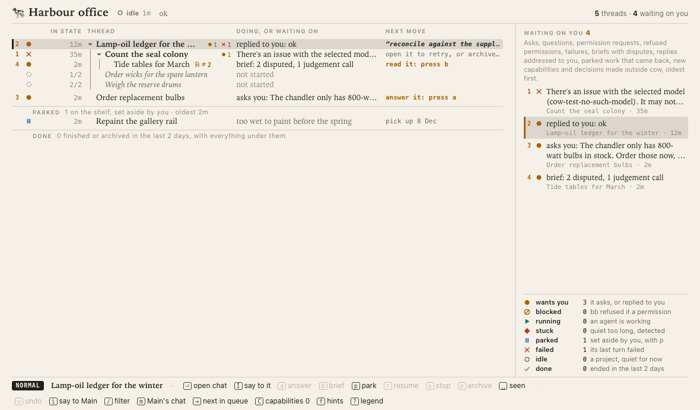
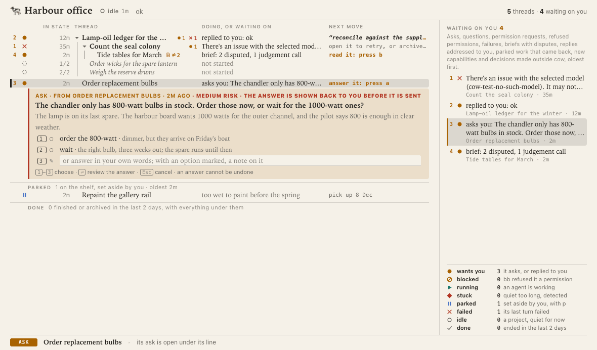

# 🐄 cow

cow is a plugin for [bb](https://getbb.app). If you run your work through one
long-lived agent thread that hands jobs to other threads, cow gives you one
page for all of it: every thread that was started, what state it is in and
for how long, what it is doing, and, in a queue of its own, only the things
that are waiting on you. You drive it from the keyboard, in the manner of
vim. It is for someone who has more agent threads open than they can keep in
their head.






The pictures are of invented threads made for this page, in cow's own theme.

## Contents

[Install](#install) · [The first five minutes](#the-first-five-minutes) ·
[The ideas](#the-ideas) · [Keys](#keys) · [The CLI, for agents](#the-cli-for-agents) ·
[What cow stores and sends](#what-cow-stores-and-sends) ·
[Limits, and what cow rests on](#limits-and-what-cow-rests-on) ·
[Updating](#updating) · [Removing](#removing) ·
[Developing and testing](#developing-and-testing) · [Licence](#licence)

The rules behind each idea, in full, are in
[docs/reference.md](docs/reference.md). What changed between versions is in
[CHANGELOG.md](CHANGELOG.md).

## Install

You need bb 0.49 and `git` on your `PATH`.

```sh
bb plugin install git:https://github.com/jamie-meyer/cow.git@^0.2.0
```

bb shows the source and the exact tag and commit it resolved, and asks before
it installs. A plugin is code that runs inside bb's server with full trust,
so read that line. Then bb clones the repository, installs cow's one runtime
dependency ([zod](https://zod.dev)) from the npm registry without running any
install script, and builds the page and the backend itself. Nothing built is
committed to this repository, and there is no release asset to download.

Check that it is there:

```sh
bb plugin list        # cow@0.2.0  running
bb cow help
```

Then open cow from its entry in bb's navigation, or go to
`/plugins/cow/main` at bb's address.

Other ways bb can install it, and when to prefer them:

| Command | Follows | Use it when |
| --- | --- | --- |
| `bb plugin install git:https://github.com/jamie-meyer/cow.git@^0.2.0` | tagged releases from 0.2.0 up to, not including, 0.3.0 | the default: `bb plugin update cow` brings fixes and nothing else |
| `bb plugin install git:https://github.com/jamie-meyer/cow.git@v0.2.0` | that one tag; bb refuses it if the tag is ever moved | you review a version before you run it |
| `bb plugin install https://github.com/jamie-meyer/cow` | the default branch, every commit | you want what is newest and accept what is unreleased |
| `git clone`, `npm install`, `bb plugin install .` | your checkout, in place | you are changing cow: see [Developing and testing](#developing-and-testing) |

cow is not on npm and not in a bb marketplace.

## The first five minutes

1. **Open cow.** With no Main chosen, the page says what it is for and lists
   your threads. A **Main** is the one long-lived thread you talk to and ask
   to hand work to others. Move with `j` and `k`, choose with `Enter`. If you
   have no thread yet, start one in bb and come back. `M` changes Main later.
2. **Read the notice about the key.** The first browser to open cow has a
   signing key made for it and enrolled, and the page says so with the key's
   fingerprint. From then on, what only you may do on the page is signed with
   that key. Press `f` and the letter on "understood", or click it. `C` lists
   the enrolled keys whenever you want to see them.
3. **Give Main something to delegate.** Press `i`, type a request that needs
   more than one thread ("start a thread that … and another that …"), and
   `Enter`. Each thread Main starts appears as a line under the heading, and
   threads those start are indented under them.
4. **Look around.** `j` and `k` move between lines; `Enter` opens a line's
   chat beside the list and `Esc` closes it. `?` opens the legend: every mark
   and every key. `f` puts a letter on everything you could click.
5. **Deal with what waits on you.** The queue at the side is only that. `Tab`
   goes to its next entry; `a` on a line answers its question or its
   permission request; `Space` marks a reply as seen.
6. **Set something aside.** `p` parks a line with a reason and a date to pick
   it up; it comes back to the queue by itself. `e` archives a finished line
   with a reason. `u` undoes the last of these.
7. **Let agents use it.** cow ships a skill that bb gives to every agent
   thread, so agents know the `bb cow` commands without being told. From a
   terminal, `bb cow status` prints the same overview as text.

If cow's own look appeals, `bb theme set plugin:cow:cow` turns on its theme
for the whole of bb, and `bb theme reset` goes back. The page mentions this
once.

## The ideas

Each of these has a section with the full rules in
[docs/reference.md](docs/reference.md).

**Main, projects and workers.** Main is the page's heading. A thread Main
started is a line; a thread with threads under it is a **group** that folds
(`h`, `l`). A **project** is a thread you talk to over days: Main, any group's
head, or a line you mark with `P`. A project is never done; quiet, it reads
idle and keeps its place. Everything else is a worker: it does a job, reports
to the thread that started it, and reads done. Each window keeps its own
Main.

**Lines and states.** A line shows a state mark, time in that state, the
thread's name, what it is doing or waiting on, and the next move.

| Mark | State | Means |
| --- | --- | --- |
| ● | wants you | it asked you something, or replied to you and you have not seen it |
| ⊘ | blocked on a permission | bb refused it a command or a file change without asking you |
| ▶ | running | a turn is in progress |
| ◆ | stuck | running with no event for 2 hours, or waiting on you for 7 days |
| ‖ | parked | you set it aside; it is on the shelf until it comes back |
| ✕ | failed | its last turn ended in an error |
| ○ | idle | a project with nothing to say |
| ✓ | done | finished or archived in the last 2 days; older ones are only counted |
| ◌ | not started | not a thread: work a thread has listed for later |

**The queue.** Only what is yours, oldest first: asks, questions, permission
requests, permissions bb refused without asking, failures, briefs with
disputes or judgement calls, replies addressed to you, parked work that has
come back, capabilities you have not acknowledged, and permission requests
decided somewhere other than cow. `Tab` and `1` to `9` jump to an entry.

**Answering, and permissions.** `a` opens whatever the line asks under the
line. A digit only marks a choice and `Enter` sends it, so no single key
answers or grants anything. For a permission request you see the exact
command or the file and its diff, and bb's choices. When bb refused something
without asking (it does that on a turn another thread started), `a` offers to
ask again as you, after which bb does ask.

**Asks.** A question an agent writes in prose scrolls away. `bb cow ask`
records one question that stays in your queue until you answer it on the page
or the thread withdraws it. The agent can give options and say how much is at
stake; a high-risk answer has to be typed out before it is sent. Your answer
reaches the thread as a message from you.

**Briefs and the checker.** A finished job is reported with
`bb cow brief submit`: a list of claims, each labelled by the agent as
checked, inferred or not checked, with its evidence. cow has a separate agent
audit it, one that sees only the brief, and `b` shows you what that checker
disputes first. A check is one model's reading of the evidence the agent
chose to attach. It is not proof, and a failed check is shown as a failure,
never as a pass.

**Parking.** `p` takes a line off the tree with a reason and a pick-up: a
date, `+3d`, `+2w`, a condition in words, or nothing. It returns to the queue
when the date arrives, or every four weeks without one, and then `r` resumes
it, `p` keeps it parked and `x` drops it.

**Capabilities.** A worker that must write outside its workspace, or run a
command outside bb's sandbox, raises a permission request each time. A
capability is a named grant (write under one directory, or run one command)
for one thread, a thread and everything under it, or everything under Main.
When a request is covered entirely, cow answers bb "allow once" for you and
writes it in a log. Only you make and delete capabilities (`C`), and every
new one sits in your queue until you acknowledge it.

**Signing.** bb does not tell a plugin who is calling it, and serves a
plugin's interface to any local process. So everything only you may do
(answering an ask, deciding a permission request, sending a message as you,
making or deleting a capability, approving a key) is accepted only when it is
signed by a key your browser holds. The first page to open cow is enrolled;
any other browser asks and is approved from an enrolled one. This has limits,
stated in [What cow stores and sends](#what-cow-stores-and-sends).

**The reader.** A file named in a chat, a brief or an ask opens over the
page, read-only, with vim's keys for moving and searching.

## Keys

The page starts in normal mode. Typing in any field works as usual, and while
a prompt is open no key does anything else. Select a line, then press a verb:
the bar at the bottom shows which verbs apply to it, and a greyed-out one
says why, and what to press instead. `?` shows this map on the page.

**Moving around**

| Key | Does |
| --- | --- |
| `j` `k` | next, previous line (arrows work too); the heading, Main, is the line above the first |
| `gg` `G` | the heading, the last line |
| `h` `l` | fold, unfold a group; on a member, h goes to its group's head (left, right arrows too) |
| `Tab` | next entry in the queue of what waits on you (Shift+Tab previous) |
| `1` to `9` | jump to that entry in the queue |
| `/` | filter: type to narrow the page to matching lines; Ctrl+n, Ctrl+p or arrows move, Enter keeps the line, Esc cancels |
| `f` | letter hints on every line, action, link and button in view, the chat's included; again for a menu it opened. A hint on a file opens it in the reader |

**Reading a thread and talking to it**

| Key | Does |
| --- | --- |
| `Enter` | open the line's chat beside the overview, or switch the pane to it; it never types into the chat |
| `m` | open Main's chat the same way |
| `;` `'` | scroll the open chat down, up a few lines, from the overview; : and " by half a page; \ goes to its newest message |
| `i` | type in the chat that is open, wherever the cursor is: the only key that does; with no chat open, say something to Main |
| `I` | say something to the selected thread |
| `Esc` | leave the chat, then close it; cancel a prompt |

**Dealing with what waits on you**

| Key | Does |
| --- | --- |
| `a` | answer the line's ask or question, grant or deny its permission request, or deal with a permission bb refused: digits choose, Enter confirms; an ask with more at stake is shown back first, or needs a word typed. A request or a refusal can be saved as a capability from its card |
| `b` | open the line's brief over the page: disputes first. In it: j k move, l or Enter opens a claim's evidence, h closes it, a answers a judgement call, c runs the check again (y confirms), q or Esc closes |
| `Space` | mark a reply as seen: the line stops waiting on you; on a line whose request was decided outside cow, acknowledge that |

**Setting work aside, ending it, taking it back**

| Key | Does |
| --- | --- |
| `p` | park it: a reason, then 19 Nov, +3d, +2w, a condition, or nothing |
| `r` | resume a parked line: back into the tree |
| `e` | archive a done, idle or failed line: a reason or nothing, then Enter |
| `x` | stop a running turn (y confirms); on parked work that came back, drop it, with a reason; on a not-started item, remove it |
| `u` | undo the last park, resume, archive, dismissal, mark as seen or project mark (y confirms). A sent message, an answer, a decision and a stopped turn cannot be undone |
| `P` | mark a line as a project, or unmark it: a project is never done; when quiet it reads idle and stays in the tree |
| `J` `K` | move a not-started item down, up its list |

**Capabilities and this page's key**

| Key | Does |
| --- | --- |
| `c` | show the capabilities the line's thread holds, and where each comes from: itself, a thread above it, or Main; c or Esc closes |
| `C` | the capabilities sheet over the page: n makes one, x deletes (y confirms), u undoes a delete, Enter shows its history, Space acknowledges a new one or a decision made outside cow, Tab shows the log, q or Esc closes. It also lists the keys enrolled to act as you, this page's among them: Enter approves a page that asks, x refuses or removes one |

**Reading a file**

| Key | Does |
| --- | --- |
| in the reader | a file opens over the page, read-only: j k move, Ctrl+d Ctrl+u half a page, Ctrl+f Ctrl+b a page, gg G and 12G, { } by block, / searches with n N, f hints its links, r raw Markdown, u splits a diff, y Y copy the path, o opens it in bb's panel, q or Esc goes back |

**The page itself**

| Key | Does |
| --- | --- |
| `M` | choose a different Main for this window |
| `?` | this legend; ?, q or Esc closes it |

A confirmation takes `y`; any other key cancels it. Keys with Cmd, Ctrl or
Alt are left to bb, apart from the ones named above.

## The CLI, for agents

`bb cow` gives an agent what it is meant to do: raise an ask, submit a brief,
ask for a capability, leave the notes the page shows, and read the overview.
The plugin ships a skill, [`skills/cow/SKILL.md`](skills/cow/SKILL.md), which
bb gives to agent threads and which says when to use each.

```sh
bb cow status [--main <thread>]                  # the overview as text
bb cow ask --question <text> [--option <label>[::<detail>]]... [--risk low|medium|high] [--context <text>] [--proof <path>]...
bb cow asks [--thread <id>] [--all]
bb cow ask withdraw <id>
bb cow ask close <id> --answered <the answer you were given>
bb cow brief submit <file.json> [--wait]
bb cow brief show <thread>
bb cow brief check <thread>                      # not on your own brief
bb cow caps                                      # the capabilities your thread holds
bb cow caps log
bb cow cap request --kind dir|command --rule <text> --why <text>
bb cow next <thread> "<text>" | --clear          # what is next, in the thread's own words
bb cow todo add|done|rm|list <thread> ...        # work not started
bb cow project <thread> [--clear]
bb cow park <thread> --reason <text> [--pickup <date|+3d|+2w|text>] [--stop]
bb cow resume <thread>
bb cow archive <thread> [--reason <text>]
bb cow help
```

Every command takes `--json` and `--help`. A refused command exits non-zero,
says why, and says what to do instead. There is no command that answers an
ask, decides a permission request, or makes, deletes or acknowledges a
capability: those are yours, on the page.

## What cow stores and sends

Written for someone who has to decide whether this may run on their machine.
Each statement is about the code in this repository at this version; how it
was checked is at the end.

### What is stored, and where

Everything is on the machine bb's server runs on, or in your browser. cow has
no storage of its own outside bb.

| Where | What |
| --- | --- |
| bb's database (`bb.db` in bb's data directory, which `bb status` prints), table `plugin_kv`, rows with `plugin_id = 'cow'` | Which thread is Main for each bb project. Which reply of each thread you have seen. Every ask: the question, options, context, the answer you gave, and when. Every brief: its claims and a copy of the text of each piece of evidence as it was when submitted, with the checker's verdicts and, for a failed check, the checker's raw answer. Every capability, its notices, and counts of use. The log: each capability made or deleted, each request a capability allowed, each decision made on the page, the first 300 characters of each message sent as you, each ask answered, each key enrolled, requested, refused or removed, and each reset, with the fingerprint of the key that signed it. The public halves of the enrolled keys |
| the same database, table `thread_plugin_metadata`, rows with `plugin_id = 'cow'` | cow's notes on a thread: why it is parked and until when, why it was archived, which refused permissions you dismissed, what the thread says is next and has not started, whether it is marked a project |
| the same database, table `plugin_settings` | the four settings of the checker, below |
| `plugins/cow/reset-enrollment` under bb's data directory | nothing, normally. You create this empty file to reset enrollment; cow deletes it when it sees it |
| bb's log for the plugin (`plugins/cow/logs/plugin.log` under bb's data directory), written by bb | a warning when something cow tried failed: what it was, a thread id, and the error's text |
| the browser, IndexedDB database `cow-signing`, for bb's address | this browser's signing key pair. The private half is created non-extractable: no script, cow's included, can read it out through the browser |
| the browser, session storage (`cow:main`, `cow:folds`) | per window: the Main it shows and the groups folded in it |
| the browser, local storage (`cow:dismissed`) | which one-time notices you have put away: the two notes below, and the notice that this page's key was enrolled |

No secret, token or credential is stored or handled. cow hands no credential
to any thread. When bb deletes a thread, cow deletes its notes on it and its
record of which reply you saw; asks, briefs, capabilities and the log are
kept until you clear them (see [Removing](#removing)).

Three things cow causes are bb's own records, not cow's: the messages it
sends to threads for you, the hidden threads it starts for the checker
(titled "cow check", archived when they answer), and bb's record that a
thread was archived or stopped.

### What leaves the machine

**cow makes no network request of its own.** Its backend and its page talk
only to the bb server they run in, through bb's plugin SDK. There is no
telemetry, no update check, no font or script fetched from anywhere, and no
address in the code but bb's own.

Two things cow does cause to be sent, both by bb, to the model provider bb is
configured with:

- **The checker.** When a brief is submitted, cow starts a hidden thread
  whose one message is the brief: its summary, its claims with the agent's
  labels, the text of the attached evidence (up to 12,000 characters a piece
  and 60,000 in all) and the list of what was not done. bb sends that to the
  provider and model set in cow's settings, or, when those are empty, to bb's
  default for the project. The evidence is whatever the agent chose to
  attach from its thread's storage, so it can hold anything that agent could
  read. To stop the automatic check:

  ```sh
  bb plugin config cow set checkOnSubmit false
  ```

  A check then runs only when you press `c` in a brief, or when a thread
  above the one that wrote it runs `bb cow brief check`.

  | Setting | Default | Means |
  | --- | --- | --- |
  | `checkOnSubmit` | on | check a brief as soon as it is submitted |
  | `checkerModel`, `checkerProvider` | empty | the checker's model and provider; empty is bb's default for the project |
  | `checkerRuns` | 1 | independent checkers per brief, up to 5 |

- **Messages you send from the page.** An answer to an ask, "ask again as
  me", a reason for a denial, and what you type with `i` and `I` are sent to
  the thread as a message from you, and reach that thread's provider as any
  message does.

Installing and updating fetch from GitHub and the npm registry; bb does that,
at your command, and cow's code is not running while it happens. On a bb that
has never built a plugin, bb also downloads its own build tools then.

The page asks bb's server for bb's version and theme, to decide whether to
show its two one-time notes. Those are requests to bb.

### What an agent can and cannot do through cow

bb gives every thread the `bb` command, and serves every plugin's interface
on the loopback address without saying who calls. So "an agent" here means
any process on the machine that can reach bb, sandboxed or not.

An agent **can**, through cow:

- raise an ask for its own thread or one under it, and withdraw or close it;
- submit a brief for its own thread or one under it, and order a check of a
  brief from a thread under it, which costs a model run;
- ask for a capability, which raises an ask and grants nothing;
- write a "next" note, a list of work not started, and the project mark, on
  its own thread and the threads under it;
- park, resume and archive threads with a reason, and read everything: the
  overview, asks, briefs, capabilities and the log;
- ask for a key to be enrolled, which shows in your queue under whatever
  name the caller gave and does nothing until an enrolled page approves it;
- by calling cow's interface directly instead of the CLI: mark a reply as
  seen, dismiss a refused permission, mark a brief as read, order a check of
  any brief, change which thread a new window starts on as Main, and park or
  archive any thread. **These are not signed and not logged.** They cannot
  grant or send anything, but they can take a line out of your queue without
  you having seen it.

An agent **cannot**, through cow: make, delete, restore or acknowledge a
capability; decide a permission request; answer an ask or close one as you;
send a message as you; approve, refuse or remove a key. Those are one method,
`signed`, which acts only on a call signed by an enrolled key over the
action, all of its arguments, a time and a nonce. A call signed more than two
minutes ago, signed before cow last started, or already used, is refused. The
list is `PERSON_ACTIONS` in `src/signing/envelope.ts`.

### The limits of signing and capabilities

- **bb's own commands are outside cow.** Any thread can approve or deny
  another thread's permission request with `bb thread interactions`, and can
  send a thread a message as you with `bb thread tell` once it clears the
  variable that names it. cow cannot stop either. A request decided that way
  is flagged "approved outside cow" in your queue until you acknowledge it. A
  message sent that way is not flagged. Deciding a request in bb's own chat
  is flagged the same way, because bb records no one for either.
- **The key is in your browser profile's files.** It cannot be exported
  through the browser, but bb's sandbox lets a thread read most of the disk.
  An agent that parsed those files could take the key and sign as you, and
  cow would not know. So could anything that drives your own browser, with
  your profile, to the page.
- **Everything else rests on bb's sandbox.** The reset file, cow's storage
  and the log are protected only by a sandboxed thread not being able to
  write under bb's data directory. A thread in bb's full-access mode is not
  sandboxed: it can create the reset file and be the next page enrolled, or
  rewrite the storage.
- **First use.** Whatever opens a cow that has no key enrolled is enrolled.
  Open cow yourself before you let agents run. If something else got there
  first, your page says in red that the key held is not its own; to take it
  back, from your own terminal:

  ```sh
  mkdir -p ~/.bb/plugins/cow && touch ~/.bb/plugins/cow/reset-enrollment
  ```

  (`~/.bb` is bb's data directory; the page prints the exact path.) cow
  clears every enrolled key, writes the reset in the log, and enrols the next
  page to open.
- **The log is evidence against a caller of the interface, not against
  someone who can write cow's storage.** Its entries are numbered and chained
  by hash, so an entry changed or removed shows as "the log is broken at
  entry N", but the chain holds no secret: a process outside the sandbox
  could rewrite the whole log so that it checks out.
- **A capability is as wide as its rule.** A prefix rule such as `python -c`
  covers whatever follows it. A directory rule is judged on the path; on a
  machine other than bb's server cow cannot follow symbolic links, and says
  so in the log. A link made after cow looked and before the write is not
  seen.
- **cow can be turned off.** `bb plugin disable` and `bb plugin remove` are
  reachable from a thread. A request raised and decided entirely while cow
  was not running is never seen.
- **The checker is a model.** "Supported" means one model read the evidence
  the agent attached and found it shows the claim. It cannot see what was
  left out.

### How this was checked

- *No network.* A search of `server.ts`, `app.tsx` and `src/` for `fetch(`,
  `XMLHttpRequest`, `WebSocket`, `EventSource`, `sendBeacon`, dynamic
  `import(`, the Node modules `http`, `https`, `net`, `dgram`, `tls`, `dns`
  and `child_process`, and any `http://` or `https://` address finds none.
  The only Node modules imported are `crypto`, `fs/promises` (to follow
  symbolic links and to delete the reset file), `os` (the home directory, for
  the rules a capability may not cover) and `path`. The same search of the
  two bundles bb builds finds no call, and three addresses, all of them names
  of JSON Schema versions inside zod, which are never fetched.
- *What is stored.* Read from the code (every `storage.kv` key prefix, every
  thread-metadata key, every use of the browser's storage), and compared with
  the rows a copy of the plugin left in bb's database after the end-to-end
  checks.
- *What an agent can and cannot do.* `npm run e2e` has a fixture thread try
  each signed action from inside bb's sandbox, unsigned and with a forged
  signature, and checks every one is refused; it also approves a request with
  `bb thread interactions` and checks cow flags it. The unsigned methods were
  called from a sandboxed shell against a copy.
- *The checker's message.* It is one function, `checkerPrompt` in
  `src/briefs/checker.ts`.

## Limits, and what cow rests on

**Tested on one combination.** bb 0.49.0, Plugin SDK 0.6.132, the Claude Code
provider, macOS, with the page in Chrome. Nothing else has been tried. The manifest accepts any bb from 0.49 and any SDK from 0.6.132, so a
newer bb will install cow; on a bb of another minor version the page says so
once.

**It reads bb the way bb 0.49 behaves.** A thread's state is worked out from
bb's thread list and event log. Detecting a permission bb refused without
asking depends on the messages bb 0.49 refuses with under the Claude Code
provider; with another provider, or a bb that words them differently, those
refusals are not detected and the rest still works. cow reads the latest
hundred or so events of a thread, and at most 5,000 threads; past that the
page says some may be missing.

**Experimental parts of bb's plugin SDK.** bb may change or remove any of
these in any release. They are listed in one place in the code,
`EXPERIMENTAL_SURFACES` in `src/support.ts`, and a test fails if the code
uses one that is not listed.

| Surface | Used for |
| --- | --- |
| `experimental_PluginRpcRefusal` (backend) | a refusal that reaches the page and the CLI with its reason |
| `experimental_dataDir` (backend) | where bb keeps its data: the reset file's place, and a place no capability may cover |
| `experimental_listAncestors` (backend) | which threads are above a thread: who may act for whom, and which capabilities apply |
| `experimental_listPluginMetadata` (backend) | finding cow's notes on threads that bb has since deleted |
| `experimental_schema` (backend) | the checkerRuns setting as a number from 1 to 5 |
| `experimental_Diff` (page) | the reader: a file change drawn as a diff |
| `experimental_SourceCode` (page) | the reader: a file drawn with highlighting and line numbers |
| `experimental_copyToClipboard` (page) | the reader: copying a path |
| `experimental_openFilePreview` (page) | the reader's o: the same file in bb's own panel |
| `experimental_useAppPanel` (page) | closing a file tab bb opened on cow's page, to show the file in the reader |
| `experimental_usePanelTabs` (page) | seeing that file tab open |

**Nothing tells cow that a thread waits on something other than you.** A
thread waiting on a build, a person or another service reads as running, then
stuck.

**One person.** cow has no notion of users: whoever holds an enrolled key is
"you".

## Updating

```sh
bb plugin outdated          # is there a newer release in the range you installed?
bb plugin update cow        # install it; bb asks first
```

An update replaces cow's code and keeps what it stored: Mains, notes on
threads, asks, briefs, capabilities, the log, enrolled keys and settings.
Reload any cow page that was open, since a page keeps the code it loaded.
[CHANGELOG.md](CHANGELOG.md) says what each version changes.

A range such as `^0.2.0` stops before 0.3.0. To move to a later range, remove
cow and install the new one:

```sh
bb plugin remove cow
bb plugin install git:https://github.com/jamie-meyer/cow.git@^0.3.0
```

Removing deletes the four settings, so set them again if you had changed
them. Everything else is still in bb's database and the new install finds
it, your enrolled key included.

## Removing

```sh
bb plugin disable cow   # stop it; everything is kept
bb plugin remove cow    # uninstall it
```

On bb 0.49, removing a plugin deletes its code and its settings and leaves
the rest of what it stored in bb's database, where nothing reads it until a
plugin with the same id is installed again. To clear that too, after
removing:

```sh
sqlite3 ~/.bb/bb.db "delete from plugin_kv where plugin_id = 'cow'; delete from thread_plugin_metadata where plugin_id = 'cow';"
rm -rf ~/.bb/plugins/cow
```

`~/.bb` is bb's data directory; `bb status` prints it. This cannot be undone.
From a checkout of this repository, the same with a count of what goes and a
check that nothing is left:

```sh
node scripts/clear-stored.mjs          # says what it would delete
node scripts/clear-stored.mjs --yes    # deletes it
```

What neither reaches is in your browser: its signing key, the dismissed
notes and each window's Main, kept in that browser's storage for bb's
address until you clear that site's data. The key is of no use once the
enrolled keys are gone. If bb's theme is still cow's, `bb theme reset`. The
threads, the archived checker threads and the messages cow sent for you are
bb's and stay.

## Developing and testing

```sh
git clone https://github.com/jamie-meyer/cow.git && cd cow
npm install
npm test             # unit tests
npm run typecheck
bb plugin install .  # registers this folder in your bb, built in place
bb plugin dev        # optional: rebuild and reload on every save
```

Both run on every push and pull request (`.github/workflows/ci.yml`). They
need Node 24 and no bb.

**Run the end-to-end checks against a copy, not against a cow you use.** They
reset enrollment, make capabilities and write to the log.
`scripts/copy-for-checks.mjs` makes a copy of the plugin under another id,
`cow-check`, with its own storage, page and command, and both scripts run
against that copy unless told otherwise:

```sh
node scripts/copy-for-checks.mjs /some/empty/folder
bb plugin install /some/empty/folder --yes
npm run e2e -- --project <bb project id> --environment <environment id>
npm run e2e:asks -- --project <bb project id> --environment <environment id>
bb plugin remove cow-check
node scripts/clear-stored.mjs --id cow-check --yes
```

`npm run e2e` drives the real page in a separate headless Chrome that you
start first (the top of `scripts/e2e.mjs` gives the command). It creates
seventeen cheap fixture threads titled "cow test", acts only on those, and
archives them afterwards. `npm run e2e:asks` checks asks and briefs without a
browser, with two more. Both set cow's checker model while they run and put
it back, and both refuse to run against the installed cow unless given
`--plugin cow --reset-the-installed-cow`. The head of each script says exactly
what it touches.

Screenshots taken while developing can show your own threads. The three in
`docs/img` were made from invented fixture threads and checked by eye; do not
commit any other.

## Licence

MIT. See [LICENSE](LICENSE).
